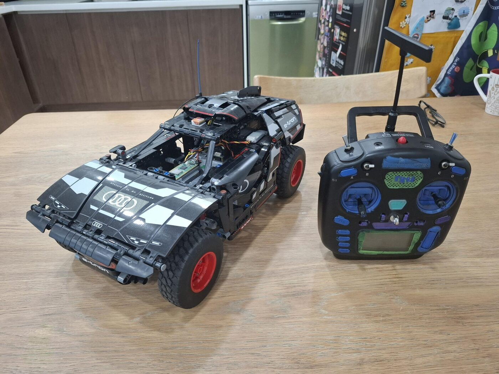
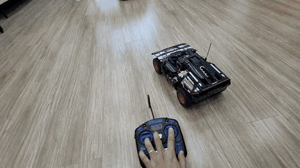
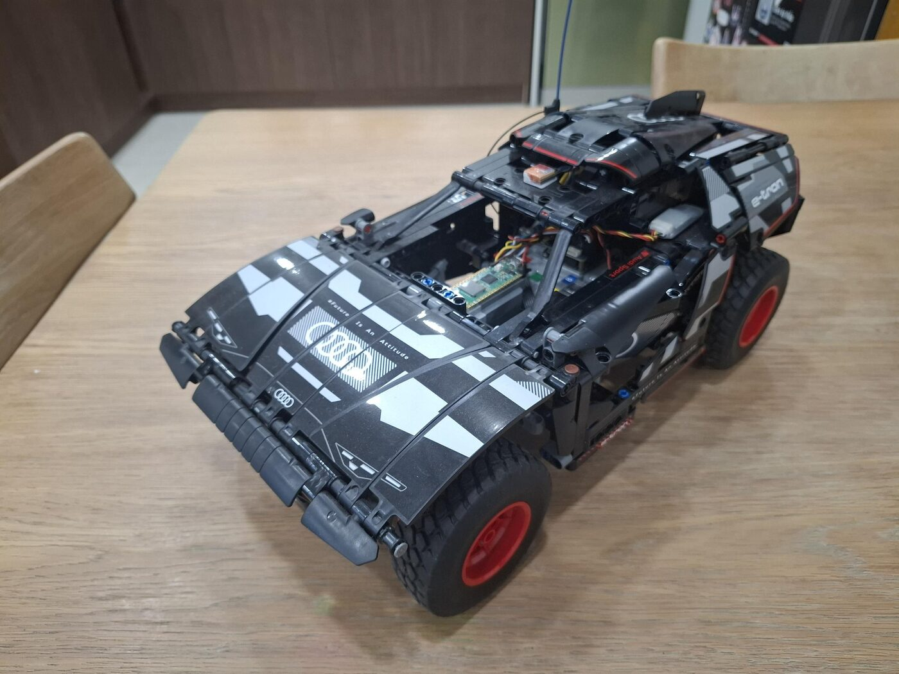

# LEGO 42160 Drive-by-Wire Gateway

Biến chiếc **LEGO Technic 42160 Audi RS Q e-tron** thành một nền tảng drive-by-wire điều khiển bằng **ArduPilot**.

Một bo **Raspberry Pi Pico W** đọc các tín hiệu PWM từ flight controller chạy ArduPilot, rồi điều khiển LEGO Technic Hub qua BLE bằng giao thức **LEGO Wireless Protocol 3 (LWP3)**. Gateway có lớp an toàn riêng, nên xe chạy được cả bằng tay điều khiển RC lẫn bằng hệ thống tự hành.

**Phiên bản hiện tại: v1.0** (11/2026), phiên bản chính thức đầu tiên, đã chạy thử trên xe.

<p align="center">
  
</p>

## Demo

Xe chạy bằng tay điều khiển RC thông qua ArduPilot:

<p align="center">
  <a href="docs/media/demo.mp4"></a>
  <br>
  <sub>Đoạn xem trước 11 giây. Bấm vào ảnh hoặc mở <a href="docs/media/demo.mp4"><code>docs/media/demo.mp4</code></a> để xem clip đầy đủ 30 giây.</sub>
</p>

<p align="center">
  
  <br>
  <sub>Pico W gateway gắn trong cabin xe.</sub>
</p>

## Kiến trúc

```
[Matek F405 Mini / ArduPilot Rover]
        │ PWM: ga (throttle), lái (steering), cho phép chạy (enable)
        ▼
[Raspberry Pi Pico W]  ── đọc PWM · lớp an toàn · BLE central
        │ BLE / LWP3
        ▼
[LEGO Technic Hub]
   ├─ Cổng A/B: motor kéo   (StartPower)
   └─ Cổng D:   motor lái   (GotoAbsolutePosition → hoạt động như servo, tự về giữa)
```

## Tính năng chính

- **Lái kiểu servo, tự về giữa:** motor lái được điều khiển theo góc tuyệt đối, có bù tỉ số truyền (~6:1) và giới hạn góc mềm để không ghì vào điểm chặn cơ khí.
- **Kết nối BLE ổn định:** vòng điều khiển chạy trong run loop của BTstack, chỉ gửi lệnh khi giá trị thay đổi (kèm làm mới định kỳ 300 ms), supervision timeout 2 s.
- **Tự phục hồi:** mỗi bước kết nối có timeout 8 s rồi tự quét lại; mất kết nối thì tự kết nối lại; watchdog phần cứng 1 s khởi động lại Pico nếu bị treo.
- **Lớp an toàn:** dừng xe và trả lái về giữa khi tắt công tắc enable, mất tín hiệu PWM, hoặc xung PWM bất thường.
- **Chẩn đoán:** log qua USB hiển thị trạng thái mỗi giây, % pin của hub, cảnh báo sụt áp/quá dòng và mã lỗi khi mất kết nối.

## Mục lục

1. [Checklist nhanh](#quick-start)
2. [Phần cứng và đấu dây](#hardware)
3. [Cài công cụ build](#tools)
4. [Đặt địa chỉ MAC của hub](#hub-address)
5. [Build firmware](#build)
6. [Nạp firmware vào Pico W](#upload)
7. [Xem log serial](#serial-log)
8. [Cấu hình ArduPilot](#ardupilot)
9. [Chạy lần đầu và kiểm tra an toàn](#first-run)
10. [Căn chỉnh lái](#steering)
11. [Bảng tham số](#config)
12. [Cơ chế an toàn](#safety)
13. [Xử lý sự cố](#troubleshooting)
14. [Cấu trúc repo và kế hoạch phát triển](#repo)

---

<a id="quick-start"></a>
## 1. Checklist nhanh

Dành cho lúc đã làm rồi và chỉ cần nhắc lại:

```bash
# một lần: cài công cụ + SDK (xem mục 3)
export PICO_SDK_PATH=~/pico/pico-sdk

# build
cmake -S . -B build
cmake --build build -j

# nạp: giữ BOOTSEL, cắm USB, chép file vào ổ RPI-RP2
cp build/lego_dbw.uf2 /media/$USER/RPI-RP2/      # Linux
# hoặc: picotool load -fx build/lego_dbw.uf2

# xem log serial
screen /dev/ttyACM0 115200                        # thoát: Ctrl-A rồi K
```

Sau đó: bật hub → bật Pico → đợi `[BLE] READY` → gạt công tắc enable → chạy.

---

<a id="hardware"></a>
## 2. Phần cứng và đấu dây

| Thiết bị | Ghi chú |
|---|---|
| LEGO 42160 + Technic Hub | Hub dùng hộp pin AA riêng |
| Matek F405 Mini | Firmware ArduPilot **Rover**; cấp nguồn riêng |
| Raspberry Pi Pico W | Cấp nguồn qua USB hoặc đường 5 V (chân VSYS) |
| 3 dây tín hiệu + 1 dây GND | **Bắt buộc nối chung GND giữa Matek và Pico** |
| Cáp micro-USB | Để nạp firmware và đọc log |

| Ngõ ra Matek | Tín hiệu | Chân Pico |
|---|---|---|
| S1 | Ga (throttle) | GP2 (chân số 4) |
| S2 | Lái (steering) | GP3 (chân số 5) |
| S3 | Cho phép chạy (enable / deadman) | GP4 (chân số 6) |
| GND | Mass | chân GND bất kỳ (ví dụ chân số 3) |

Không có dây nối tới hub LEGO; hub chỉ giao tiếp qua BLE.

> Chân vào của Pico là 3,3 V. Ngõ ra PWM của các bo F405 thông thường là 3,3 V nên nối thẳng được. Không nối nguồn tín hiệu 5 V.

---

<a id="tools"></a>
## 3. Cài công cụ build

Cần ba thứ: **CMake**, **trình biên dịch chéo ARM GCC** và **Pico SDK 2.2.x** (kèm các submodule). Chọn một trong các cách dưới đây.

### Cách A: VS Code + extension Raspberry Pi Pico (dễ nhất, mọi hệ điều hành)

1. Cài [VS Code](https://code.visualstudio.com/).
2. Cài extension **"Raspberry Pi Pico"** (nhà phát hành: Raspberry Pi).
3. Mở thư mục repo này trong VS Code. Khi extension đề nghị import project, chọn **SDK 2.2.0** và board **pico_w**.
4. Extension tự tải SDK, trình biên dịch, CMake, Ninja và picotool. Dùng nút **Compile Project** và **Run Project** thay cho mục 5–6.

Nếu chọn cách này, chuyển thẳng tới [mục 4](#hub-address).

### Cách B: Dòng lệnh trên Linux (Ubuntu / Debian / WSL2)

```bash
sudo apt update
sudo apt install -y git cmake build-essential python3 \
    gcc-arm-none-eabi libnewlib-arm-none-eabi libstdc++-arm-none-eabi-newlib \
    libusb-1.0-0-dev pkg-config
```

### Cách B: Dòng lệnh trên macOS

```bash
brew install cmake libusb pkg-config
brew install --cask gcc-arm-embedded
```

### Tải Pico SDK (chỉ cho cách B)

```bash
mkdir -p ~/pico && cd ~/pico
git clone -b 2.2.0 https://github.com/raspberrypi/pico-sdk.git
cd pico-sdk
git submodule update --init      # tải btstack, cyw43-driver, tinyusb, lwip, ...
```

Khai báo đường dẫn SDK cho CMake. Thêm dòng này vào `~/.bashrc` (hoặc `~/.zshrc` trên macOS) để không phải gõ lại:

```bash
export PICO_SDK_PATH=~/pico/pico-sdk
```

> Thiếu submodule là lỗi build hay gặp nhất. Nếu thấy `pico/stdio_usb.h: No such file` hoặc `btstack.h: No such file`, chạy lại `git submodule update --init` trong thư mục SDK.

---

<a id="hub-address"></a>
## 4. Đặt địa chỉ MAC của hub

Firmware chỉ kết nối tới **một hub cụ thể**, xác định bằng địa chỉ MAC Bluetooth. Sửa dòng này ở đầu file `src/lego_dbw_system.c`:

```c
static const bd_addr_t HUB_ADDR = { 0x90, 0x84, 0x2B, 0x7F, 0xD4, 0x40 };   // 90:84:2B:7F:D4:40
```

Nếu vẫn dùng hub cũ thì giữ nguyên. Để tìm địa chỉ của hub khác, dùng một trong hai cách:

- **App điện thoại:** cài **nRF Connect** (Android/iOS), bật hub (đèn nhấp nháy), quét và tìm thiết bị tên **"Technic Hub"**. Địa chỉ hiện ngay dưới tên.
- **Dùng chính Pico:** đặt `#define DEBUG_PRINT_ADV_REPORTS 1`, build và nạp, rồi đọc các dòng `[ADV]` trong log. Xong thì đặt lại `0`.

> **Tắt app LEGO Control+ / Powered Up trên điện thoại.** Hub chỉ nhận một kết nối; nếu điện thoại đang kết nối thì Pico không bao giờ vào được.

---

<a id="build"></a>
## 5. Build firmware

Trong thư mục repo:

```bash
cmake -S . -B build
cmake --build build -j
```

Lần build đầu mất vài phút vì phải build thêm `picotool` và `pioasm` từ mã nguồn (cần mạng và trình biên dịch C/C++ thông thường của máy). Các lần sau chỉ mất vài giây.

Kết quả là file **`build/lego_dbw.uf2`**, đây là file để nạp.

Nếu chỉ sửa file `.c`, chạy lại `cmake --build build -j` là đủ. Nếu sửa `CMakeLists.txt` hoặc build có hiện tượng lạ, xoá thư mục `build` rồi chạy lại cả hai lệnh.

Ghi chú về build:
- Chỉ dùng BLE: project định nghĩa `CYW43_LWIP=0` nên không kéo theo stack lwIP/WiFi.
- `config/btstack_config.h` bật `ENABLE_LE_PERIPHERAL` bên cạnh `ENABLE_LE_CENTRAL`. Vai trò peripheral không được dùng, nhưng file `hci.c` của BTstack trong SDK 2.2 không biên dịch được nếu thiếu nó.

---

<a id="upload"></a>
## 6. Nạp firmware vào Pico W

### Cách 1: Kéo thả (luôn dùng được)

1. **Rút** cáp USB của Pico W.
2. **Giữ nút BOOTSEL** màu trắng trên Pico W.
3. **Cắm** cáp USB trong khi vẫn giữ nút. Thả nút sau khoảng một giây.
4. Máy tính hiện một ổ USB tên **`RPI-RP2`**.
5. **Chép file `build/lego_dbw.uf2` vào ổ đó.**
6. Ổ đĩa tự biến mất và Pico khởi động lại với firmware mới. Đây là bình thường, không phải lỗi.

Trên WSL2, chép file từ Windows Explorer: thư mục build nằm ở `\\wsl$\<distro>\home\<user>\...`.

### Cách 2: picotool (từ lần thứ hai không cần bấm nút)

Khi firmware này đang chạy, picotool tự chuyển Pico sang chế độ nạp qua USB:

```bash
picotool load -fx build/lego_dbw.uf2
# -f: ép Pico đang chạy vào chế độ BOOTSEL, -x: chạy chương trình sau khi nạp
```

`picotool` đã được build trong lần build đầu. Nếu chưa có trong PATH, tìm nó trong `build/_deps/picotool/`. Trên Linux, nếu báo lỗi quyền truy cập thì dùng `sudo` hoặc cài udev rules của picotool.

### Cách 3: Extension VS Code

Bấm **Run Project** trong thanh bên của extension (Pico phải đang cắm; extension dùng picotool).

---

<a id="serial-log"></a>
## 7. Xem log serial

Firmware in log qua USB dưới dạng cổng serial ảo (baud rate nào cũng được; thường dùng 115200).

| Hệ điều hành | Cổng | Lệnh |
|---|---|---|
| Linux / WSL | `/dev/ttyACM0` | `screen /dev/ttyACM0 115200` (thoát: Ctrl-A, K, rồi Y) hoặc `minicom -D /dev/ttyACM0` |
| macOS | `/dev/tty.usbmodem*` | `screen /dev/tty.usbmodem* 115200` |
| Windows | `COMx` (xem trong Device Manager) | PuTTY (Serial, COMx, 115200), hoặc extension **Serial Monitor** của VS Code |

Sau khi khởi động, firmware đợi tối đa 5 giây cho chương trình đọc serial rồi mới chạy tiếp, nên mở log nhanh nếu muốn xem những dòng đầu tiên.

Log khởi động bình thường trông như sau:

```
=== LEGO DBW Pico W v1.0 ===
[BLE] scanning...
[BLE] hub seen rssi=-58 -> connect
[BLE] connecting to 90:84:2B:7F:D4:40...
[BLE] connected handle=0x0040 interval=24 x1.25ms
[GATT] discover all primary services...
[GATT] 4 services
[GATT] selected (LEGO UUID): write=0x000e (WO_RESP) notify=0x000e
[BLE] READY
[HUB] port 0x00 attached io_type=0x002e
[HUB] battery 87%
[DBG] ble=1 st=6 | thr=1500 str=1500 en=1900 | armed=1 | thr_cmd=0 steer=0mdeg | tx ok=12 drop=0
```

Các con số cụ thể (handle, RSSI, io type) sẽ khác. Điều quan trọng là thấy `[BLE] READY`, sau đó mỗi giây có một dòng `[DBG]`.

Cách đọc dòng `[DBG]`:
- `ble=1`: đã kết nối và sẵn sàng.
- `thr`, `str`, `en`: độ rộng xung đo được (µs). `(stale)` nghĩa là chân đó không có tín hiệu hợp lệ.
- `armed=1`: cả ba tín hiệu đều mới và enable trên 1600 µs.
- `tx ok` / `drop`: số lệnh được stack BLE nhận / từ chối.

---

<a id="ardupilot"></a>
## 8. Cấu hình ArduPilot

Pico cần ba tín hiệu **PWM 50 Hz** tiêu chuẩn, dải 1000–2000 µs, điểm giữa 1500 µs. Trong Mission Planner (Config → Full Parameter List), firmware Rover:

| Tham số | Giá trị | Ý nghĩa |
|---|---|---|
| `SERVO1_FUNCTION` | `70` | Throttle → S1 → GP2 |
| `SERVO2_FUNCTION` | `26` | GroundSteering → S2 → GP3 |
| `SERVO3_FUNCTION` | `50 + N` | `RCPassThruN`: chép nguyên kênh RC số N → S3 → GP4 (ví dụ `55` = RCPassThru5) |
| `SERVO_RC_FS_MSK` | `4` (bit của ngõ ra 3) | **Bắt buộc.** Khi mất sóng RC, ngõ ra 3 về mức trung tính thay vì giữ giá trị cuối |
| `SERVO1..2_MIN / TRIM / MAX` | `1000 / 1500 / 2000` | Khớp với cách Pico quy đổi |

Ghi chú:
- Gán **enable** cho một công tắc hai vị trí trên tay điều khiển, rồi dùng số kênh đó cho `SERVO3_FUNCTION`. Công tắc lên (> 1600 µs) = cho phép chạy; công tắc xuống = dừng và trả lái về giữa. Đây là công tắc deadman, độc lập với trạng thái arm của ArduPilot.
- **Vì sao cần `SERVO_RC_FS_MSK`:** ngõ ra passthrough mặc định giữ giá trị hợp lệ cuối cùng khi mất sóng RC. Thiếu tham số này, nếu tắt tay điều khiển lúc công tắc enable đang bật thì xe vẫn ở trạng thái cho phép chạy. Cách kiểm tra: bật enable, tắt tay điều khiển, xem `en` trong dòng `[DBG]` có xuống dưới 1600 µs và `armed` về 0 không.
- Ngõ ra passthrough chép nguyên xung đầu vào; các tham số `SERVO3_MIN/TRIM/MAX` không có tác dụng.
- Ngõ ra phải là PWM thường, không phải DShot hay OneShot.
- Nếu ngõ ra không có tín hiệu, kiểm tra xe đã arm chưa và nút safety trên bo có đang chặn ngõ ra không (`BRD_SAFETY_DEFLT`).
- Đối chiếu giá trị tham số với danh sách tham số của phiên bản ArduPilot đang dùng.

---

<a id="first-run"></a>
## 9. Chạy lần đầu và kiểm tra an toàn

**Kê xe lên giá cho bánh không chạm đất** trong lần chạy đầu tiên sau mỗi lần thay firmware.

1. **Chỉnh bánh trước về giữa bằng tay**, rồi bật Technic Hub (lý do xem [mục 10](#steering)). Đèn hub nhấp nháy.
2. Cấp nguồn cho flight controller và Pico W. Mở log serial.
3. Đợi `[BLE] READY`. Đèn hub chuyển từ nhấp nháy sang sáng đứng khi Pico đã kết nối.
4. Kiểm tra dòng `[DBG]` có độ rộng xung hợp lý ở cả ba kênh.
5. Arm ArduPilot (chế độ Manual), gạt công tắc enable lên → `armed=1`.
6. Thử lái trước với biên độ nhỏ, sau đó mới thử ga.

Sau đó chạy các bài kiểm tra sau một lần:

| Bài kiểm tra | Kết quả mong đợi |
|---|---|
| Gạt công tắc enable xuống khi đang chạy | Motor dừng, lái về giữa |
| Tắt tay điều khiển khi enable đang bật | `armed=0`: motor dừng, lái về giữa (cần `SERVO_RC_FS_MSK`, mục 8) |
| Rút dây ga S1 | Trong vòng 250 ms: motor dừng, lái về giữa |
| **Giữ ga rồi rút nguồn Pico** | **Xác nhận hub tự dừng motor.** Khi mất kết nối BLE, Pico không gửi được lệnh dừng. Nếu xe vẫn chạy, coi đây là rủi ro đã biết |
| Tắt hub rồi bật lại | Log báo mất kết nối, rồi `scanning`, rồi `READY` mà không cần đụng vào Pico |

---

<a id="steering"></a>
## 10. Căn chỉnh lái

**Vị trí giữa.** `GotoAbsolutePosition` tính góc từ vị trí của motor lái **tại thời điểm bật hub**. Nếu lúc bật hub bánh đang lệch thì "vị trí giữa" cũng lệch theo. Luôn chỉnh bánh về giữa bằng tay trước khi bật hub. (Routine tự căn chỉnh nằm trong kế hoạch phát triển.)

**Giới hạn góc lái.** Ép motor lái vào điểm chặn cơ khí ở công suất cao sẽ kéo dòng lớn, có thể làm sụt áp và khiến hub khởi động lại. Cách tìm giới hạn an toàn:

1. Đặt `STEER_MOTOR_DEG_LIMIT` ở mức thấp, ví dụ `120`. Build và nạp.
2. Đẩy cần lái hết về một phía, xem bánh có đánh hết lái không.
3. Tăng giới hạn mỗi lần khoảng 20° cho đến khi bánh vừa đánh hết lái mà motor không gồng hay kêu rè.
4. Đặt giá trị cuối cùng thấp hơn điểm đó khoảng 10%.

`STEER_GEAR_RATIO` (6) đổi góc bánh sang góc motor; `STEER_TARGET_DEG_MAX` (40) là góc bánh yêu cầu khi đẩy hết cần lái, trước khi áp giới hạn.

---

<a id="config"></a>
## 11. Bảng tham số

Mọi tham số nằm ở đầu file `src/lego_dbw_system.c`. Sau khi sửa phải build và nạp lại.

| Tham số | Mặc định | Ý nghĩa |
|---|---|---|
| `HUB_ADDR` | `90:84:2B:7F:D4:40` | Địa chỉ MAC của Technic Hub **của bạn** |
| `GPIO_PWM_THROTTLE / STEERING / ENABLE` | 2 / 3 / 4 | Các chân đầu vào |
| `ENABLE_THRESHOLD_US` | 1600 | Kênh enable phải trên ngưỡng này mới cho phép chạy |
| `PWM_TIMEOUT_MS` | 250 | Quá thời gian này không có xung mới thì coi như mất tín hiệu |
| `PWM_DEADBAND_US` | 30 | Vùng chết quanh 1500 µs |
| `THROTTLE_MAX_POWER` | 100 | Công suất kéo tối đa (0–100) |
| `STEER_TARGET_DEG_MAX` | 40 | Góc bánh khi đẩy hết cần lái |
| `STEER_GEAR_RATIO` | 6 | Số độ motor cho mỗi độ bánh (đo được ~6:1) |
| `STEER_MOTOR_DEG_LIMIT` | 240 | **Cần đo theo xe, xem mục 10** |
| `STEER_GOTO_SPEED` | 80 | Tốc độ đánh lái (1–100) |
| `STEER_GOTO_MAXPOWER` | 80 | Càng thấp càng ít dòng khi chạm điểm chặn |
| `CONN_SUPERVISION_TO` | 200 (2 s) | Supervision timeout của kết nối BLE |
| `DEBUG_PRINT_ADV_REPORTS` | 0 | Đặt 1 để liệt kê mọi thiết bị BLE quét được |

---

<a id="safety"></a>
## 12. Cơ chế an toàn

Gateway ra lệnh **ga = 0 và lái về giữa** khi có bất kỳ điều kiện nào sau:
- kênh enable dưới ngưỡng hoặc mất tín hiệu,
- kênh ga hoặc lái mất tín hiệu (> 250 ms),
- xung nằm ngoài khoảng 800–2200 µs (bị loại như nhiễu).

Khi mất kết nối BLE, gateway không gửi được lệnh nào. Lúc đó hành vi của xe phụ thuộc vào firmware của hub (xem bài kiểm tra ở [mục 9](#first-run)).

Watchdog phần cứng 1 s khởi động lại Pico nếu vòng lặp bị treo; log lúc khởi động sẽ báo nếu lần trước bị watchdog reset.

---

<a id="troubleshooting"></a>
## 13. Xử lý sự cố

### Build và nạp

| Hiện tượng | Cách xử lý |
|---|---|
| Không thấy ổ `RPI-RP2` | Giữ BOOTSEL *trước khi* cắm cáp. Thử cáp khác: nhiều cáp micro-USB chỉ sạc, không truyền dữ liệu |
| Không tìm thấy `pico/stdio_usb.h` / `btstack.h` | Thiếu submodule SDK: chạy `git submodule update --init` trong thư mục SDK |
| Chưa đặt `PICO_SDK_PATH` | `export PICO_SDK_PATH=~/pico/pico-sdk`, xoá `build/` rồi chạy lại CMake |
| Không thấy cổng serial sau khi nạp | Đợi vài giây; kiểm tra Device Manager / `ls /dev/ttyACM*`. Nếu vẫn không có, firmware có thể bị treo: nạp lại bằng BOOTSEL |
| `picotool` báo lỗi quyền (Linux) | Dùng `sudo`, hoặc cài udev rules của picotool |

### Kết nối

| Hiện tượng | Nguyên nhân thường gặp |
|---|---|
| Kẹt ở `[BLE] scanning...` | Hub chưa bật, `HUB_ADDR` sai, hoặc app LEGO trên điện thoại đang kết nối với hub |
| `setup timeout` lặp lại | Sóng yếu hoặc hub bận; đặt Pico gần hub hơn, khởi động lại hub một lần |
| `[DBG]` báo `(stale)` ở một kênh | Dây chưa nối, **chưa nối chung GND**, hoặc ngõ ra ArduPilot chưa cấu hình / chưa arm |
| `armed=0` dù cả ba kênh đều có tín hiệu | Công tắc enable đang ở vị trí thấp (≤ 1600 µs) |
| Lái không về đúng giữa | Lúc bật hub bánh chưa ở giữa (mục 10) |

### Mã lỗi khi mất kết nối

Khi mất kết nối, log in ra mã lý do:

| Mã | Ý nghĩa | Cần kiểm tra |
|---|---|---|
| `0x08` | Connection timeout | Sóng RF, hoặc hub bị khởi động lại: xem ngay trước đó có cảnh báo `LOW VOLTAGE` / `HIGH CURRENT` không. Thử pin mới và giảm giới hạn góc lái |
| `0x13` | Remote user terminated | Hub chủ động ngắt (lỗi, pin yếu, bấm nút) |
| `0x3E` | Failed to establish | Kết nối không thành công; firmware tự thử lại |
| `[BOOT] ... WATCHDOG` | Pico đã bị treo | Lưu lại log để phân tích |

Bộ đếm `drop` tăng đều nghĩa là lệnh được tạo ra nhanh hơn tốc độ đường truyền chấp nhận.

---

<a id="repo"></a>
## 14. Cấu trúc repo và kế hoạch phát triển

```
├── src/lego_dbw_system.c     firmware (một file duy nhất)
├── config/btstack_config.h   cấu hình BTstack
├── CMakeLists.txt            định nghĩa build
├── pico_sdk_import.cmake     script tìm Pico SDK (chuẩn của Raspberry Pi)
└── docs/media/               ảnh và video demo
```

### Kế hoạch phát triển

- Routine tự căn chỉnh lái (tìm hai điểm chặn, tính vị trí giữa)
- Đọc PWM bằng PIO
- Hệ số lái theo tốc độ, điều khiển tốc độ vòng kín
- Gửi telemetry về ArduPilot
